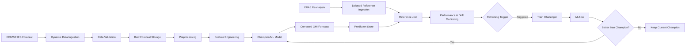

# Malang Solar MLOps

> An evolving MLOps project for short-term solar irradiance forecast correction in Malang, Indonesia, using ECMWF IFS, ERA5, DVC data versioning, MLflow experiment tracking, model lifecycle management, and local inference verification.

---

## Overview

`malang-solar-mlops` is an evolving Machine Learning Operations (MLOps) project focused on improving short-term solar irradiance forecasts for Malang, Indonesia.

Instead of predicting solar irradiance entirely from scratch, this project applies **machine-learning-based forecast correction**. A numerical weather prediction model first produces a raw solar irradiance forecast, then a machine learning model learns historical forecast errors and estimates a correction that brings the forecast closer to an ERA5 reanalysis reference.

The project is designed as an incrementally developed MLOps system covering:

- dynamic data ingestion,
- automated data validation and preprocessing,
- feature engineering,
- data versioning,
- model training and experiment tracking,
- model registry and serving,
- drift and performance monitoring,
- automated retraining,
- and continuous model delivery.

---

## Problem Formulation

Solar irradiance forecasts are important inputs for estimating short-term photovoltaic (PV) energy potential. However, numerical weather prediction models may exhibit systematic errors caused by cloud conditions, atmospheric variability, forecast horizon, seasonality, and changes in the upstream weather model.

This project formulates the problem as **supervised regression through residual correction**.

For each forecast:

```text
residual = ERA5 reference GHI - raw forecast GHI
```

The machine learning model predicts this residual, and the corrected forecast is calculated as:

```text
corrected GHI = raw forecast GHI + predicted residual
```

where GHI refers to **Global Horizontal Irradiance**, expressed in W/m².

---

## Data Sources

### Operational Forecast

The final pipeline is designed around **ECMWF IFS HRES forecasts** accessed through the **Open-Meteo Single Runs API**.

Single Runs preserve information about individual forecast runs, allowing the project to explicitly track:

- `run_time` — when the forecast model was initialized,
- `valid_time` — the time being predicted,
- `lead_time` — the forecast horizon.

The initial project scope focuses on short-term forecasts from **+1 to +6 hours**.

Forecast features include:

| Feature | Description |
|---|---|
| Temperature | Forecast air temperature at 2 m |
| Relative humidity | Forecast atmospheric humidity |
| Precipitation | Forecast precipitation |
| Cloud cover | Forecast cloud coverage |
| Pressure | Mean sea-level pressure |
| Wind speed | Forecast wind speed at 10 m |
| Wind direction | Forecast wind direction |
| Raw GHI | Raw shortwave radiation forecast |
| Lead time | Forecast horizon in hours |
| Time features | Cyclical hour and seasonal representations |

### Reference Target

**ERA5 reanalysis** is used as the reference target for evaluating historical forecasts.

ERA5 is treated as a **reference / proxy ground truth**, not as a direct physical sensor measurement from a pyranometer in Malang.

Because ERA5 becomes available after a delay, model performance monitoring is designed to operate asynchronously. Forecasts can be ingested and preprocessed immediately, while their corresponding ERA5 references are collected later.

This separation allows the operational forecast pipeline to continue running without waiting for delayed labels.

---

## Initial Feasibility Study

Before finalizing the operational data pipeline, an initial feasibility study was conducted using the Open-Meteo Historical Forecast API and ERA5.

The historical feasibility dataset covered:

```text
2023-01-01 → 2026-08-17
```

with:

```text
31,800 hourly observations
100% temporal completeness
0 missing timestamps
0 duplicate timestamps
```

A temporal train-test split was used rather than a random split:

```text
Training : 2023 → 2025
Testing  : 2026
```

Evaluation was restricted to daylight observations to avoid artificially low errors caused by nighttime GHI values near zero.

### Initial Results

| Model | MAE (W/m²) | RMSE (W/m²) | Bias (W/m²) | Improvement |
|---|---:|---:|---:|---:|
| Raw forecast | 79.41 | 120.13 | +49.71 | Baseline |
| Linear Regression correction | 65.93 | 94.97 | +19.67 | +16.98% |
| Random Forest correction | **61.42** | **92.28** | **+4.81** | **+22.66%** |
| HistGradientBoosting correction | 61.70 | 93.00 | +9.04 | +22.31% |

The initial experiment suggests that forecast errors contain a **learnable correction signal**.

> **Important:** these results were produced during the feasibility stage using the Historical Forecast API. Final model benchmarks will be recomputed using the ECMWF IFS Single Runs dataset so that forecast initialization time and lead time are explicitly preserved.

---

## Planned MLOps Architecture

The target production workflow is:



The final system is planned to incorporate:

| Component | Technology |
|---|---|
| Source control | GitHub |
| Development environment | GitHub Codespaces |
| Workflow automation | GitHub Actions |
| Data versioning | DVC |
| Experiment tracking | MLflow |
| Model registry | MLflow Model Registry |
| Model serving | MLflow Models / containerized service |
| Containerization | Docker |
| Service orchestration | Docker Compose |
| Metrics collection | Prometheus |
| Monitoring dashboard | Grafana |

---

## Development Environment

The repository provides a reproducible cloud-based development environment using **GitHub Codespaces** and a repository-level Dev Container configuration.

The environment is defined in:

```text
.devcontainer/devcontainer.json
```

The current Codespaces setup provides:

- Python 3.11,
- automatic dependency installation from `requirements.txt`,
- Python development support,
- Pylance,
- Jupyter support,
- and Ruff for Python linting and formatting.

Dependencies are automatically installed when a new Codespace is created.

### Environment Validation

Verify Python:

```bash
python --version
```

Expected environment:

```text
Python 3.11.x
```

Validate the main project dependencies:

```bash
python -c "import numpy, pandas, requests, sklearn, pyarrow; print('Dependencies OK')"
```

DVC and MLflow are also required by the completed local coursework implementations. Verify them in the active environment:

```bash
dvc --version
python -c "import mlflow; print('MLflow:', mlflow.__version__)"
```

Both packages are pinned in `requirements.txt`. A fresh environment can install dependencies, but it **cannot recover the local MLflow database/model artifacts or the DVC data cache** solely from the Git repository.

Expected result:

```text
Dependencies OK
```

The same source code can be executed locally or in GitHub Codespaces; data and MLflow artifact restoration across machines requires additional shared storage configuration.

---

## Branching Strategy

This repository follows a lightweight **GitHub Flow** strategy.

The `main` branch is treated as the stable integration branch. Development work is performed on dedicated branches before being merged through a Pull Request.

Branch naming conventions:

```text
feat/<feature-name>   → new feature or experiment
fix/<bug-name>        → bug fix
chore/<task-name>     → infrastructure or maintenance task
docs/<topic-name>     → documentation changes
```

Example feature-branch workflow (LK-04):

```text
main
  │
  └── feat/lk04-data-ingestion
          │
          ├── dynamic forecast ingestion
          ├── ERA5 reference ingestion
          ├── preprocessing automation
          ├── feature engineering
          ├── data validation
          └── documentation update
                  │
                  ▼
             Pull Request
                  │
              validation
                  │
                  ▼
                main
```

Example commands:

```bash
git switch main
git pull origin main
git switch -c feat/example-feature
```

After making changes:

```bash
git add .
git commit -m "feat: describe the implemented feature"
git push -u origin feat/example-feature
```

A Pull Request is then created from the feature branch into `main`. The LK-05 implementation used `feat/lk05-dvc-versioning` with separate Git commits for the first and second dataset versions. Later milestones used `feat/lk06-mlflow-tracking` and `feat/lk07-model-lifecycle`.

Changes should be validated before being merged into the stable branch.

---

## Continuous Training Strategy

The project will use a **hybrid continuous-training strategy** instead of retraining the model after every new observation.

Candidate retraining can be triggered by:

1. **Scheduled evaluation** — periodic challenger training.
2. **Performance degradation** — increasing rolling MAE, RMSE, or bias.
3. **Data drift** — persistent changes in meteorological feature distributions or prediction behavior.

Retraining does not automatically replace the production model.

A newly trained **challenger** must first be evaluated against the current **champion** using recent temporally held-out data.

Only a challenger that satisfies the model acceptance criteria should eventually be promoted in a deployed system. **LK-07 currently simulates registry promotion locally**; it does not implement an automated production gate or real deployment.

---

## Monitoring Strategy

The future production system is designed to monitor three main areas.

### Model Performance

- Rolling MAE
- Rolling RMSE
- Rolling bias
- Raw forecast vs corrected forecast performance

### Data Health

- Missing values
- Schema validity
- Value ranges
- Data freshness
- Feature drift
- Prediction drift

### Service Health

- Prediction requests
- Prediction errors
- Inference latency
- Data ingestion status

Prometheus will collect operational metrics, while Grafana will provide monitoring dashboards.

---

## Repository Structure

The repository currently follows the modular structure below. Directories holding generated data may be empty in a fresh clone because their content is intentionally not committed to Git.

```text
malang-solar-mlops/
├── .devcontainer/
│   └── devcontainer.json
├── .dvc/
│   ├── .gitignore
│   └── config
├── config/
├── data/
│   ├── raw/
│   │   ├── forecast/                    # generated ECMWF run snapshots
│   │   ├── era5/                        # generated ERA5 snapshots
│   │   ├── sample/
│   │   │   └── ecmwf_ifs_sample.csv      # small Git-tracked LK-04 sample
│   │   ├── ecmwf_ifs_history.csv        # DVC-tracked local dataset
│   │   └── ecmwf_ifs_history.csv.dvc    # Git-tracked DVC pointer
│   └── processed/
│       ├── features/                    # generated Parquet features
│       ├── era5/                        # generated clean ERA5
│       └── training/                    # generated LK-06 labeled training dataset
├── models/
├── notebooks/
├── src/
│   ├── data/
│   │   ├── ingest_data.py
│   │   ├── preprocess.py
│   │   ├── update_history.py
│   │   ├── build_training_dataset.py
│   │   ├── test_openmeteo_solar.py
│   │   └── test_single_run.py
│   └── model/
│       ├── sanity_baseline.py
│       ├── train.py                     # LK-06 tracking and V1 registration
│       └── lk07_registry.py             # LK-07 versioning and inference smoke test
├── reports/
│   ├── lk06_best_model.json             # V1 registry and source provenance
│   ├── lk06_experiment_summary.csv      # LK-06 model ranking
│   ├── lk07_model_registry.yaml         # V1/V2 lineage + active model alias
│   └── lk07_inference_result.json       # local smoke-test evidence
├── tests/
├── .dvcignore
├── .gitignore
├── LICENSE
├── README.md
└── requirements.txt
```

The dataset content itself is stored in the local DVC cache (`.dvc/cache/`) and is not part of a normal Git commit. The tracked pointer file is `data/raw/ecmwf_ifs_history.csv.dvc`.

---

## Current Development Status

| Stage | Status |
|---|---|
| Problem formulation | ✅ Completed |
| Historical data feasibility | ✅ Completed |
| ERA5 reference feasibility | ✅ Completed |
| Temporal ML sanity test | ✅ Completed |
| Standardized repository structure | ✅ Completed |
| GitHub Codespaces setup | ✅ Completed |
| Codespaces dependency validation | ✅ Completed |
| GitHub Flow infrastructure branch | ✅ Completed |
| ECMWF IFS Single Runs validation | ✅ Completed |
| Dynamic ECMWF forecast ingestion | ✅ Completed |
| ERA5 delayed-reference ingestion | ✅ Completed |
| Idempotent ingestion simulation | ✅ Completed |
| Automated forecast preprocessing | ✅ Completed |
| Automated ERA5 preprocessing | ✅ Completed |
| Basic feature engineering | ✅ Completed |
| LK-06 forecast–ERA5 labeled dataset (12 rows) | ✅ Completed (PoC) |
| Final forecast-reference dataset construction | ⏳ Planned (full-scale) |
| DVC initialization and local dataset versioning | ✅ Completed |
| DVC V1 and V2 comparison | ✅ Completed |
| DVC remote storage | ⏳ Not configured |
| MLflow experiment tracking (LK-06) | ✅ Completed (local PoC) |
| Three Random Forest hyperparameter runs | ✅ Completed (LK-06 PoC) |
| Model Registry candidate (Version 1) | ✅ Completed (local) |
| LK-07 challenger registration (Version 2) | ✅ Completed (local) |
| LK-07 V1/V2 selection using temporal validation MAE | ✅ Completed (PoC) |
| LK-07 Staging → Production lifecycle simulation | ✅ Completed (local) |
| LK-07 `@production` model loading and inference smoke test | ✅ PASS (local) |
| LK-07 DVC–MLflow lineage manifest | ✅ Completed |
| Actual production service deployment | ⏳ Not implemented |
| Final model experimentation | ⏳ Planned (larger dataset) |
| Model serving | ⏳ Planned |
| CI/CD automation | ⏳ Planned |
| Drift monitoring | ⏳ Planned |
| Prometheus & Grafana monitoring | ⏳ Planned |
| Automated continuous training | ⏳ Planned |

---

## Getting Started

There are two supported ways to work with this project:

1. GitHub Codespaces
2. Local Python environment

### Option 1 — GitHub Codespaces

Open the repository on GitHub and select:

```text
Code
→ Codespaces
→ Create codespace
```

The Dev Container configures the Python environment and installs project dependencies listed in `requirements.txt`. For LK-05, ensure DVC is included in that file or install it separately. Without a DVC remote, a fresh Codespace will have the `.dvc` metadata but **not** the versioned CSV bytes.

Verify the environment:

```bash
python --version
```

and:

```bash
python -c "import numpy, pandas, requests, sklearn, pyarrow; print('Dependencies OK')"
```

Expected result:

```text
Dependencies OK
```

---

### Option 2 — Local Development

Clone the repository:

```bash
git clone https://github.com/maulnite/malang-solar-mlops.git
cd malang-solar-mlops
```

Create a virtual environment with `uv` (Python 3.11):

```powershell
uv venv .venv --python 3.11
```

Activate it on Windows PowerShell:

```powershell
.\.venv\Scripts\Activate.ps1
```

Install dependencies with `uv`:

```powershell
uv pip install -r requirements.txt
```

If DVC is not yet included in `requirements.txt`:

```powershell
uv pip install dvc
```

`uv`-created environments may not include a `pip` module, so prefer `uv pip install` if `python -m pip` reports `No module named pip`.

Validate dependencies:

```powershell
python -c "import numpy, pandas, requests, sklearn, pyarrow; print('Dependencies OK')"
```

---

## Running Current Experiments

### Historical Data Feasibility Test

Run:

```bash
python src/data/test_openmeteo_solar.py
```

This script evaluates the availability, completeness, and structure of historical forecast and ERA5 data used during the initial feasibility stage.

---

### ECMWF IFS Single Run Test

Run:

```bash
python src/data/test_single_run.py
```

This script validates the ECMWF IFS HRES Single Runs datasource and verifies the availability of forecast horizons from +1 to +6 hours.

---

### Dynamic ECMWF Forecast Ingestion

Operational forecast ingestion is implemented in:

```text
src/data/ingest_data.py
```

Run:

```bash
python src/data/ingest_data.py --source forecast
```

The ingestion process:

- searches for the latest available ECMWF IFS run,
- retrieves forecast horizons from +1 to +6 hours,
- preserves `run_time`, `valid_time`, and `lead_time`,
- retrieves meteorological variables and raw GHI,
- performs basic ingestion checks,
- and stores a raw snapshot for each available model run.

Forecast snapshots are stored in:

```text
data/raw/forecast/
```

A typical filename is:

```text
ecmwf_ifs_20260928T0000Z.csv
```

Each ECMWF model run is stored separately so previously collected forecast data is not overwritten.

### Periodic Ingestion Safety

The forecast ingestion process is designed to be **idempotent**.

Running the ingestion script repeatedly for the same latest available ECMWF run does not create another copy of the same dataset.

For example:

```bash
python src/data/ingest_data.py --source forecast
python src/data/ingest_data.py --source forecast
```

The first execution stores the forecast snapshot.

The second execution detects that the same run has already been stored and safely skips duplicate ingestion.

Conceptually:

```text
First execution
      ↓
latest run detected
      ↓
snapshot saved

Second execution
      ↓
same latest run detected
      ↓
existing snapshot found
      ↓
duplicate ingestion skipped
```

Production scheduling is planned using **GitHub Actions**.

During LK-04, periodic execution is simulated by manually running the ingestion script multiple times.

---

### ERA5 Reference Refresh

ERA5 acts as the delayed reference for historical forecasts.

Run:

```bash
python src/data/ingest_data.py --source era5
```

The default implementation requests a conservative delayed date relative to the current UTC date so that the ERA5 reference is likely to be available.

A specific date can also be requested:

```bash
python src/data/ingest_data.py --source era5 --date 2026-08-24
```

Raw ERA5 reference data is stored in:

```text
data/raw/era5/
```

For example:

```text
data/raw/era5/era5_20260922.csv
```

ERA5 data is hourly. Therefore, one successfully retrieved reference date normally produces 24 observations.

ERA5 ingestion is also idempotent.

If a reference file for the requested date already exists, the pipeline skips duplicate ingestion instead of overwriting the existing snapshot.

Conceptually:

```text
Daily reference check
        ↓
requested ERA5 date
        ↓
already stored?
     /       \
   yes        no
    │          │
   skip       fetch
               │
               ▼
             save
```

---

### Forecast Preprocessing

Forecast preprocessing is implemented in:

```text
src/data/preprocess.py
```

Run:

```bash
python src/data/preprocess.py --source forecast
```

The preprocessing pipeline performs:

- schema validation,
- numeric datatype conversion,
- UTC timestamp normalization,
- critical missing-value checks,
- value-range validation,
- forecast time-consistency checks,
- duplicate handling,
- chronological sorting,
- cyclical time feature engineering,
- and cyclical wind-direction feature engineering.

The preprocessing stage validates relationships between:

```text
run_time
valid_time
lead_time
```

so that the stored forecast horizon remains consistent with the actual timestamp difference.

Processed forecast data is stored as Parquet files in:

```text
data/processed/features/
```

A typical generated file is:

```text
ecmwf_ifs_20260928T0000Z_features.parquet
```

---

### Generated Forecast Features

The raw weather variables are retained, including:

```text
temperature_2m
relative_humidity_2m
precipitation
cloud_cover
pressure_msl
wind_speed_10m
wind_direction_10m
raw_ghi_forecast
lead_time_hour
is_day
```

Additional deterministic time features are generated:

```text
hour
day_of_year
hour_sin
hour_cos
day_of_year_sin
day_of_year_cos
```

The hour feature is derived from local Malang time (`Asia/Jakarta`) so that the diurnal solar cycle is represented according to local daylight conditions.

Wind direction is also represented cyclically:

```text
wind_dir_sin
wind_dir_cos
```

Cyclical encoding allows the model to represent circular quantities correctly.

For example:

```text
23:00 ≈ 00:00
359°  ≈ 1°
```

rather than treating them as numerically far apart.

---

### ERA5 Preprocessing

Run:

```bash
python src/data/preprocess.py --source era5
```

This stage:

- validates the ERA5 schema,
- normalizes timestamps,
- converts reference GHI into numeric values,
- checks for invalid or missing GHI,
- removes duplicate timestamps,
- and sorts the reference time series chronologically.

Processed ERA5 reference data is stored in:

```text
data/processed/era5/
```

For example:

```text
era5_20260922_clean.parquet
```

Forecast preprocessing and ERA5 preprocessing intentionally remain independent.

The operational flow is therefore:

```text
ECMWF IFS forecast
        ↓
dynamic ingestion
        ↓
raw forecast
        ↓
forecast preprocessing
        ↓
feature-ready dataset
```

while ERA5 follows a delayed path:

```text
ERA5 becomes available
        ↓
reference ingestion
        ↓
ERA5 preprocessing
        ↓
clean reference dataset
```

A future stage will join forecast observations with their corresponding ERA5 references using `valid_time`.

---

### Forecast-Reference Join (LK-06 Proof of Concept)

The LK-06 implementation **already joins** DVC-tracked ECMWF forecast history with the delayed ERA5 reference using `valid_time_utc`:

```bash
python src/data/build_training_dataset.py
```

The generated dataset is `data/processed/training/ecmwf_ifs_labeled.parquet` and contains `actual_ghi` and the target `residual = actual_ghi - raw_ghi_forecast`. For the current two-run history, all 12 forecasts match ERA5, with 10 daylight observations available for modeling.

This is a **small local proof of concept**. The larger, continuously updated, DVC-versioned training snapshot remains a future goal.

---

### Initial ML Sanity Test

The historical feasibility dataset must be generated first.

Then run:

```bash
python src/model/sanity_baseline.py
```

The script compares raw forecast performance with several residual-correction models using temporal evaluation.

The current sanity test is used only to demonstrate that a learnable correction signal exists before the final Single Runs training dataset is constructed.

---

## Dataset Versioning with DVC (LK-05)

LK-05 introduces **Data Version Control (DVC)** to track the historical ECMWF forecast dataset independently of Git. This is **dataset versioning**, not yet automated model retraining.

### Tracked Dataset and Data-Flow Separation

Each successful ingestion creates an immutable-by-convention snapshot named after its model initialization time:

```text
data/raw/forecast/ecmwf_ifs_YYYYMMDDTHHMMZ.csv
```

To demonstrate data growth while retaining original snapshots, `update_history.py` maintains the aggregated historical CSV:

```text
data/raw/ecmwf_ifs_history.csv
```

DVC tracks that aggregate dataset via its Git-committed pointer:

```text
data/raw/ecmwf_ifs_history.csv.dvc
```

The three responsibilities remain separate:

```text
Open-Meteo Single Runs API
          |
          v
src/data/ingest_data.py
          |
          v
data/raw/forecast/           (per-run raw CSV snapshots)
          |
          v
src/data/update_history.py  (append only previously unseen records)
          |
          v
data/raw/ecmwf_ifs_history.csv
          |
          v
dvc add                    (cache data and update .dvc pointer)
          |
          v
Git commit                 (version the pointer alongside code)
```

`preprocess.py` runs independently on a raw forecast snapshot to validate schema, timestamps, missing values, value ranges, and derive cyclical features. Updating the aggregate history **does not automatically** execute DVC or model retraining; these are currently manual commands.

### Initializing DVC

From the repository root, with DVC installed:

```bash
dvc init
```

Commit the DVC configuration generated by initialization (`.dvc/config`, `.dvc/.gitignore`, and `.dvcignore`). The existing repository has already been initialized; **do not repeat `dvc init` for normal use**.

### Dataset V1 — First Historical Snapshot

For the initial LK-05 demonstration, the six-row LK-04 sample was copied into the historical dataset:

```powershell
Copy-Item data/raw/sample/ecmwf_ifs_sample.csv data/raw/ecmwf_ifs_history.csv
```

Track it with DVC:

```bash
dvc add data/raw/ecmwf_ifs_history.csv
git add .dvc/config .dvc/.gitignore .dvcignore data/raw/ecmwf_ifs_history.csv.dvc
git commit -m "chore: initialize DVC and track forecast dataset v1"
```

Recorded LK-05 V1 Git commit: `f0d1ee2`.

### Dataset V2 — Simulated Continual Data Arrival

Fetch the latest run and validate its snapshot:

```bash
python src/data/ingest_data.py --source forecast
python src/data/preprocess.py --source forecast
```

Append records from the latest snapshot to the existing history:

```bash
python src/data/update_history.py
```

The update script identifies a unique forecast observation using:

```text
(source_model, run_time_utc, valid_time_utc)
```

Rows already present in history are skipped, so repeated execution with the same run is idempotent. You can also select a specific CSV snapshot with `--input`:

```bash
python src/data/update_history.py --input data/raw/forecast/ecmwf_ifs_20261009T0600Z.csv
```

For the LK-05 demonstration, the historical dataset expanded from **6 rows in V1 to 12 rows in V2** using two distinct forecast runs. Re-running the update on the same latest snapshot reported `New rows: 0`, confirming duplicate prevention.

Record V2:

```bash
dvc status
dvc add data/raw/ecmwf_ifs_history.csv
git add src/data/update_history.py data/raw/ecmwf_ifs_history.csv.dvc
git commit -m "feat: version expanded ECMWF forecast dataset v2"
```

Recorded LK-05 V2 Git commit: `53b3966`.

### Audit, Verification, and Dataset Diff

Inspect local data consistency:

```bash
python -c "import pandas as pd; d=pd.read_csv('data/raw/ecmwf_ifs_history.csv'); print('Rows:',len(d)); print('Runs:',d['run_time_utc'].nunique()); print('Duplicates:',d.duplicated(['source_model','run_time_utc','valid_time_utc']).sum())"
```

Inspect repository and DVC status:

```bash
git status
dvc status
```

Compare the two committed dataset versions:

```bash
dvc diff HEAD~1 HEAD --show-hash
```

In the LK-05 demonstration, DVC reported **one modified dataset** (`data/raw/ecmwf_ifs_history.csv`) with a changed content hash. The two tracked commits provide a reproducible audit trail **provided the DVC data objects are accessible**.

To inspect metadata for either Git revision directly:

```bash
git show f0d1ee2:data/raw/ecmwf_ifs_history.csv.dvc
git show 53b3966:data/raw/ecmwf_ifs_history.csv.dvc
```

**Important:** `dvc diff` compares tracked file metadata and content hashes; it does not display per-row CSV differences. The row count and duplicate check above independently verify data growth.

### Reproducibility and Current Limitations

- Git tracks the DVC pointer file, DVC configuration, source code, and documentation.
- DVC stores CSV contents in its **local cache**, not in the Git repository.
- **No DVC remote is configured yet.** A fresh clone or Codespace cannot restore these dataset versions automatically from GitHub alone. A shared object-storage remote (for example, S3, MinIO, or another DVC-supported backend) and `dvc push`/`dvc pull` would be needed for that workflow.
- GitHub Actions scheduling, automated `dvc add`, a full-scale rolling reference join, and continuous retraining are not implemented yet. A small labeled reference join and MLflow experiment tracking have been demonstrated in LK-06 and local model lifecycle management in LK-07.
- LK-05 demonstrates an append-only historical dataset and two different tracked versions; it does not yet constitute a complete continually trained production model.

---

## MLflow Experiment Tracking and Model Registry (LK-06)

### Goal and Relation to the DVC Dataset

LK-06 integrates **MLflow Tracking** and **MLflow Model Registry** into the Malang solar irradiance residual-correction project. The input is the DVC-tracked ECMWF forecast history established in LK-05, enriched with time-aligned ERA5 reference GHI.

The experiment remains a **proof of concept**: the versioned ECMWF history currently includes 12 forecast rows from two model runs, yielding 10 daylight observations (6 train and 4 validation). These are enough to demonstrate reproducible logging, comparison, and model registration, but **not enough to claim generalization or production readiness**.

### Build the Supervised Dataset

From the repository root, retrieve the delayed ERA5 references needed for the two currently versioned forecast dates:

```bash
python src/data/ingest_data.py --source era5 --date 2026-09-28
python src/data/ingest_data.py --source era5 --date 2026-10-09
python src/data/build_training_dataset.py
```

`build_training_dataset.py` reuses LK-04 preprocessing, merges ECMWF with ERA5 by `valid_time_utc`, and creates:

```text
data/processed/training/ecmwf_ifs_labeled.parquet
```

For each matched timestamp, the regression target is:

```text
residual = actual_ghi - raw_ghi_forecast
corrected_ghi = max(0, raw_ghi_forecast + predicted_residual)
```

The 12 current forecast records all matched ERA5, with no missing residual targets. The supervised train/validation split is **temporal by forecast run**, not a random row split, to reduce temporal leakage. Model validation is restricted to daylight observations.

### Train and Track Experiments

The required package is `mlflow` (record the exact installed version in `requirements.txt`). In the `uv` environment, install project dependencies with:

```bash
uv pip install -r requirements.txt
```

Run the experiments:

```bash
python src/model/train.py
```

The script uses the local SQLite-backed tracking database `sqlite:///mlflow.db` and the experiment name:

```text
LK06-Malang-Solar-Residual-Correction
```

It executes three Random Forest residual regressors on the same temporal validation split:

| Run name | `n_estimators` | `max_depth` | `min_samples_leaf` |
|---|---:|---:|---:|
| RF-50-depth3 | 50 | 3 | 1 |
| RF-100-depth6 | 100 | 6 | 1 |
| RF-200-leaf2 | 200 | None | 2 |

Each successful MLflow run logs hyperparameters, validation metrics (`val_mae`, `val_rmse`, `val_bias`), raw forecast baseline MAE, the percentage MAE improvement, the fitted scikit-learn model, and experiment provenance including the LK-05 DVC forecast content hash. The experiment also records the Git revision when available.

### Observed Results — 19 October 2026

Results below were observed for **6 daylight training rows** and **4 daylight validation rows**, with a raw forecast validation MAE of **73.500 W/m²**.

| Run | Validation MAE (W/m²) | RMSE (W/m²) | Bias (W/m²) | MAE improvement |
|---|---:|---:|---:|---:|
| RF-100-depth6 | **69.750** | 86.699 | -1.510 | **+5.102%** |
| RF-50-depth3 | 70.437 | 87.510 | +0.643 | +4.168% |
| RF-200-leaf2 | 72.866 | **86.278** | -9.451 | +0.863% |

The selection criterion is **lowest validation MAE**, so `RF-100-depth6` was selected. Although `RF-200-leaf2` produced the lowest RMSE, its MAE was higher. These comparisons illustrate experiment selection behavior only; the dataset is far too small for trustworthy model-performance claims.

### MLflow UI and Model Registry

Start the local UI from the repository root:

```bash
mlflow server --backend-store-uri sqlite:///mlflow.db --port 5000
```

Open `http://127.0.0.1:5000` to inspect Training runs, select the three **FINISHED** runs, and compare hyperparameters and validation metrics using the run comparison visualizations. An earlier failed run due to restricted `skops` model types may remain in the run history; exclude it from the three-run comparison.

After the three successful runs, the script registers the best model in MLflow Model Registry:

```text
Registered model : MalangSolarResidualCorrector
Version          : 1
Alias            : lk06-candidate
Selected run     : RF-100-depth6
Criterion        : minimum validation MAE
```

The alias denotes a **candidate for future evaluation**, not a deployed or production champion. Model registry entries and artifacts are retained locally in the MLflow backing store/artifact storage unless a shared tracking server is configured.

The script writes these additional outputs:

```text
reports/lk06_best_model.json
reports/lk06_experiment_summary.csv
```

`lk06_best_model.json` contains the source MLflow run ID, registered model/version/alias, model URI, validation metrics, dataset DVC MD5, and Git revision. Hyperparameters appear in the summary CSV and MLflow run. Do not handcraft run IDs: use metadata produced by the actual local execution.

### Limitations and Reproducibility

- Only two ECMWF forecast runs have been ingested into the DVC history; only one run is used for training and one for validation.
- The current MLflow registry is local. No centralized MLflow server or shared artifact backend is configured.
- The DVC remote is not configured; a fresh Codespace will not automatically receive the history dataset, even if Git has its `.dvc` metadata.
- The labeled dataset is generated locally and is excluded from ordinary Git tracking.
- MLflow Tracking and selection are demonstrated in LK-06. LK-07 subsequently demonstrates a **manual local** staging/production alias transition and programmatic model loading; automated retraining and real service deployment are not implemented.

---

## MLflow Model Registry, Model Versioning, and Inference Readiness (LK-07)

### Goal and Scope

LK-07 extends the LK-06 model artifact into a controlled local model lifecycle. It registers a second version, compares both versions, demonstrates the legacy `None → Staging → Production` progression requested in the coursework, tracks DVC lineage in a lightweight YAML manifest, and loads the version selected for the **local Production simulation** for an inference smoke test.

**Scope warning:** `Production` below is a registry label/alias on a local MLflow instance. There is no deployed inference service, real-time monitoring, or production-validated model. With six training and four validation samples, this remains an educational proof of concept.

### Model Registry Versions and Selection

Both versions use the same feature columns, DVC forecast dataset version, and forecast-run-based temporal split. The target is the ERA5–ECMWF residual, and the selection criterion is **minimum daylight validation MAE**.

| Property | Version 1 (LK-06) | Version 2 (LK-07) |
|---|---:|---:|
| Model | Random Forest | Random Forest |
| `n_estimators` | 100 | 150 |
| `max_depth` | 6 | 5 |
| `min_samples_leaf` | 1 | 1 |
| `random_state` | 42 | 42 |
| Validation MAE (W/m²) ↓ | **69.750** | 70.820 |
| Validation RMSE (W/m²) ↓ | **86.699** | 86.988 |
| Validation bias (W/m²) | −1.510 | −3.873 |
| Legacy model stage (final) | **Production** | None |
| Registry role | Selected for local Production simulation | Challenger |

Version 1 is selected because its MAE is **1.070 W/m² lower** than Version 2 on the same four-row validation set. The result is a decision for the coursework simulation, **not** evidence of reliable out-of-sample superiority.

Registry details:

```text
Registered model : MalangSolarResidualCorrector
Version 1 run ID : dd660965540c45a286eb238e70411f00
Version 2 run ID : 6aa9e20405df4dd7b21eabf3f09c193b
Selected version : 1
Active model URI : models:/MalangSolarResidualCorrector@production
Challenger alias : lk07-challenger → Version 2
Dataset DVC MD5 : 5ed231ffe84c086adc1ee80957693395
```

The `@production` alias resolves to **Version 1** and is the source of truth for the local inference smoke test. The `@staging` alias also points to Version 1 from the preceding transition. `@lk06-candidate` (V1) and `@lk07-challenger` (V2) are also visible in MLflow UI. Aliases and legacy stages are distinct concepts.

### Prerequisites and Local Tracking

Execute commands **from the repository root**, using the same machine and Python environment that still hold the LK-06 SQLite database, its MLflow artifact store, the LK-05 DVC data, and the locally generated labeled training dataset:

```powershell
.\.venv\Scripts\Activate.ps1
python -c "import mlflow; print(mlflow.__version__)"
dvc status
Test-Path mlflow.db
Test-Path reports/lk06_best_model.json
Test-Path data/processed/training/ecmwf_ifs_labeled.parquet
```

The LK-07 script refuses to proceed without the LK-06 registry Version 1 and checks that the DVC forecast hash still matches the earlier model provenance. **Do not rerun `dvc init` or retrain LK-06 just to perform LK-07.**

Local MLflow UI:

```powershell
mlflow server --backend-store-uri sqlite:///mlflow.db --port 5000
```

Open `http://127.0.0.1:5000` and navigate to **Model Registry → MalangSolarResidualCorrector**. Note that the SQLite URI is a local path, not a shared public tracking server.

### Register Version 2

Inspect the registry before registration:

```powershell
python src/model/lk07_registry.py status
```

Train the challenger and create Version 2:

```powershell
python src/model/lk07_registry.py register-v2
```

This command trains a Random Forest with 150 trees, max depth 5, and min leaf size 1; logs its metrics and artifact in MLflow experiment `LK07-Malang-Solar-Model-Lifecycle`; registers Version 2 in `MalangSolarResidualCorrector`; and sets the alias `lk07-challenger`. It also writes `reports/lk07_model_registry.yaml`.

**Do not rerun `register-v2` once Version 2 exists.** The script prevents silently generating another model version.

Check both versions:

```powershell
python src/model/lk07_registry.py status
```

### Local Staging and Production Transition

To reproduce the recorded lifecycle simulation with the selected Version 1:

```powershell
python src/model/lk07_registry.py stage --version 1
python src/model/lk07_registry.py production --version 1
python src/model/lk07_registry.py status
```

The initial Version 1 stage was `None`. The Staging command records the Staging transition and sets `@staging` to V1. The Production command then records the Production transition and sets `@production` (and `@champion`) to V1.

MLflow legacy model-version stages are deprecated. For compatibility with the coursework, the script tries a legacy stage transition but uses the **modern alias `production`** to resolve the model during inference. Running the Staging command again *after* Production can change the legacy stage back to Staging; finish the sequence with the Production command.

The registry version's `aliases` list in some local SDK metadata responses was displayed as `[]`, even though aliases were visible in MLflow UI and could be resolved successfully. Verify the active version using the explicit `Staging alias` / `Production alias` values printed by the script and the successful alias-based model load, rather than interpreting the list `aliases: []` in the manifest as absence of an alias.

### Programmatic Inference Smoke Test

After the Production alias points to the intended version, execute:

```powershell
python src/model/lk07_registry.py infer
```

The script loads the saved artifact with MLflow's PyFunc interface:

```python
model = mlflow.pyfunc.load_model(
    "models:/MalangSolarResidualCorrector@production"
)
```

It uses one feature row from the existing local validation data and computes:

```text
corrected_ghi = max(0, raw_forecast_ghi + predicted_residual)
```

Observed local LK-07 smoke-test output:

| Field | Value |
|---|---:|
| Registry alias resolved | `@production` → V1 |
| Forecast valid time (UTC) | `2026-10-09 07:00:00+00:00` |
| Raw forecast GHI | 662.0 W/m² |
| Predicted residual | −52.2 W/m² |
| Corrected forecast GHI | **609.8 W/m²** |
| ERA5 reference (offline check only) | 474.0 W/m² |
| Result | **`INFERENCE SMOKE TEST: PASS`** |

The smoke test verifies that a registered model artifact can be **resolved, loaded, and used to compute a finite prediction** with the expected features. It does not establish general model quality or a deployed inference endpoint. ERA5 is included only as a delayed/offline reference and is **not** required to execute forecast-time inference.

The generated evidence file is:

```text
reports/lk07_inference_result.json
```

### DVC–MLflow Metadata and Data Lineage

The registry manifest is stored at:

```text
reports/lk07_model_registry.yaml
```

It records:

- the model name and local MLflow backend URI;
- the LK-05 DVC pointer `data/raw/ecmwf_ifs_history.csv.dvc` and MD5 `5ed231ffe84c086adc1ee80957693395`;
- the local labeled dataset path;
- Version 1 and Version 2, their run IDs and registered model URIs;
- validation MAE/RMSE and hyperparameters;
- the training Git revisions (`c510b50` for V1, `791e6c4` for V2);
- the active `staging_version` and `production_version` (both V1 in the recorded run);
- `local_simulation_only: true`.

This metadata connects the **versioned forecast source** to the **specific training runs** and selected model version. It does not copy model weights into Git, version the labeled training Parquet itself with DVC, or make local MLflow artifacts remotely accessible.

### Versioning, Reproducibility, and Remaining Work

Git should track:

```text
src/model/lk07_registry.py
reports/lk07_model_registry.yaml
reports/lk07_inference_result.json
README.md
```

Git intentionally ignores `mlflow.db*`, `mlruns/`, `mlartifacts/`, the local Python virtual environment, DVC cache, and generated feature/training files. Model binary artifacts are still owned by the **local MLflow artifact store**.

LK-07 establishes **manual local model lifecycle management and inference readiness at the artifact level**, but not online serving or safe automated release promotion. Future work includes significantly expanding the training data, proper temporal validation, versioning labeled datasets in DVC, shared MLflow tracking/artifact storage, API/container serving, monitoring, and controlled deployment gates.

---

## Data Versioning Policy

Operational raw forecasts, raw ERA5 references, and processed datasets are generated dynamically. They are not committed as ordinary large Git files:

```text
data/raw/forecast/
data/raw/era5/
data/processed/features/
data/processed/era5/
data/processed/training/
```

The small representative LK-04 sample under `data/raw/sample/` remains Git-tracked for coursework verification.

LK-05 adds a separate **DVC-tracked aggregate history**:

| Artifact | Versioned by | Purpose |
|---|---|---|
| `src/data/*.py` | Git | Data pipeline source code |
| `data/raw/sample/ecmwf_ifs_sample.csv` | Git | Small LK-04 evidence file |
| `data/raw/forecast/*.csv` | Local generated storage | Per-run raw snapshots |
| `data/raw/ecmwf_ifs_history.csv` | DVC local cache | Aggregated forecast history |
| `data/raw/ecmwf_ifs_history.csv.dvc` | Git | Hash-based pointer to DVC data |
| `data/processed/**/*.parquet` | Local generated storage | Clean, feature-ready outputs |
| `reports/lk06_*.json`, `reports/lk06_*.csv` | Git | Experiment selection and provenance |
| `reports/lk07_model_registry.yaml` | Git | Model V1/V2 lineage and active alias metadata |
| `reports/lk07_inference_result.json` | Git | Reproducible evidence of local smoke test |
| `mlflow.db*`, `mlruns/`, `mlartifacts/` | Local MLflow storage (Git-ignored) | Tracking/registry DB and model artifacts |

**Git commits do not upload the historical CSV data itself.** DVC remote storage is a separate, optional future enhancement for sharing complete historical datasets across machines and Codespaces.

---

## Current Data Pipeline

The LK-04 ingestion/preprocessing pipeline, LK-05 DVC history, and LK-06/LK-07 local learning/model lifecycle demonstrations connect as follows:

```text
                 Dynamic Data Sources
                         │
          ┌──────────────┴──────────────┐
          │                             │
          ▼                             ▼
   ECMWF IFS HRES                     ERA5
          │                             │
          ▼                             ▼
   ingest_data.py                ingest_data.py
 --source forecast               --source era5
          │                             │
          ▼                             ▼
 data/raw/forecast/              data/raw/era5/
          │                             │
          ▼                             ▼
   preprocess.py                  preprocess.py
 --source forecast               --source era5
          │                             │
          ▼                             ▼
data/processed/features/    data/processed/era5/
          │                             │
          └──────────────┬──────────────┘
                         │
                         ▼
              LK-06 PoC valid_time join
                         │
                         ▼
                  residual target
                         │
                         ▼
              training-ready dataset
```

The LK-04 pipeline completes dynamic ingestion and automated preprocessing while preserving the delayed nature of the ERA5 reference. LK-05 also feeds ECMWF raw snapshots into `update_history.py`, creating `data/raw/ecmwf_ifs_history.csv` for DVC versioning. LK-06 now uses the DVC history snapshot, joins it with delayed ERA5, and runs a **small local MLflow proof of concept** for model tracking and registration. This join is not yet a complete production-scale, continuously updated training pipeline. LK-07 adds the Version 2 challenger, simulated Staging/Production promotion of V1 through MLflow, and a local `@production` inference smoke test.

---

## Project Direction

The repository has progressed from **problem formulation and datasource feasibility** to ingestion/preprocessing (LK-04), local dataset versioning (LK-05), MLflow experiment tracking and candidate registration (LK-06), and a manually controlled registry/inference simulation (LK-07).

The following stages have now been implemented:

```text
datasource feasibility
        ↓
Single Runs validation
        ↓
dynamic forecast ingestion
        ↓
ERA5 reference ingestion
        ↓
idempotent ingestion
        ↓
automated preprocessing
        ↓
basic feature engineering
        ↓
aggregated forecast history
        ↓
DVC versioning (V1 → V2)
        ↓
ERA5 join and residual label (PoC)
        ↓
3 Random Forest MLflow runs
        ↓
Model Registry candidate v1
        ↓
Version 2 challenger in same Registry
        ↓
V1/V2 comparison (validation MAE)
        ↓
V1 Staging → local Production alias
        ↓
model loading + inference smoke test PASS
```

The next major milestones are:

1. collect substantially more ECMWF Single Runs history with matching delayed ERA5 labels,
2. build and DVC-version the final production training dataset,
3. configure a shared DVC remote for reproducible `dvc push`/`dvc pull`,
4. move local MLflow tracking and artifacts to an accessible shared backend,
5. train and validate future challengers on a representative temporal holdout,
6. containerize and serve a properly evaluated accepted champion model,
7. automate ingestion and evaluation using GitHub Actions,
8. monitor system and model performance,
9. detect drift and performance degradation,
10. automate retraining and benchmark challengers against the champion,
11. deploy improved models through a controlled workflow.

The long-term objective is a reproducible pipeline capable of:

```text
fetch
  ↓
validate
  ↓
preprocess
  ↓
feature engineering
  ↓
predict
  ↓
store
  ↓
observe
  ↓
monitor
  ↓
retrain
  ↓
evaluate
  ↓
deploy
```

while keeping the production model, datasets, experiments, and infrastructure versioned and reproducible.

---

## License

This project is licensed under the **MIT License**.

See the `LICENSE` file for details.
